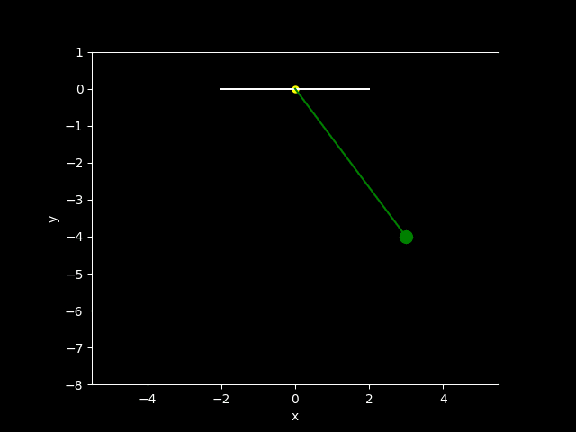

# DAE-solver

Численное решение дифференциально-алгебраической системы для задачи о колебании стержня фиксированной длины. В [solver.py](solver.py) реализована схема Розенброка; результаты сравниваются для коэффициентов `α = 1` и `α = (1 + i) / 2`.

## Визуализация



## Запуск

Нужны Python, NumPy и Matplotlib:

```bash
python -m pip install numpy matplotlib
python solver.py
```

Скрипт откроет график сравнения длины стержня при двух значениях `α`.

## Графики

- [Координата x(t)](results/x.png) и [координата y(t)](results/y.png)
- [Длина стержня √(x² + y²)](<results/l(t).png>)
- [Сравнение схем Розенброка](results/compare.png)
